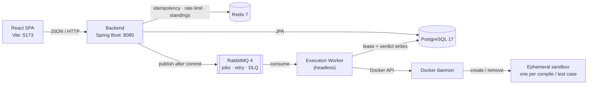

# Online Judge

[](https://github.com/AtharvaAgalawe/Online-Judge/actions/workflows/ci.yml)
[](LICENSE)


A full-stack, production-style online judge. Users browse problems, submit source code in one of
six languages, and get a verdict after their code is compiled and executed against hidden test
cases inside ephemeral, locked-down Docker containers.

The project is built around the three problems a real judge actually has — **correctness under
concurrency and failure**, **safe execution of untrusted code**, and **throughput** — rather than
around CRUD. The API never blocks on judging, every submission's journey is persisted, and
submitted code never runs outside the sandbox.

| | |
|---|---|
| **Stack** | Java 21 · Spring Boot 3.5 · PostgreSQL 17 · RabbitMQ 4 · Redis 7 · React 18 + TypeScript |
| **Pipeline** | `POST /submissions` → PostgreSQL + RabbitMQ → execution worker → Docker sandbox → verdict |
| **Languages** | Java 21, Python 3.12, C 17, C++ 17, JavaScript (Node 22), Go 1.23 |
| **Trust boundary** | Only `execution-worker` touches the Docker socket. The backend has zero Docker dependencies. |
| **Spec** | [`PRD.md`](PRD.md) (what & why) · [`AGENTS.md`](AGENTS.md) (engineering rules) |

> **Just want it running?** [Quick start](#quick-start-local-development) for a development
> setup, or [Deployment](#deployment) for the full stack in containers on one host.

## Contents

- [Features](#features)
- [Architecture](#architecture)
- [Verdicts](#verdicts)
- [Design decisions](#design-decisions)
- [Technology stack](#technology-stack)
- [Repository layout](#repository-layout)
- [Quick start (local development)](#quick-start-local-development)
- [Using the app](#using-the-app)
- [API](#api)
- [Configuration](#configuration)
- [Testing and verification](#testing-and-verification)
- [Deployment](#deployment)
- [Security model](#security-model)
- [Project status](#project-status)
- [Troubleshooting](#troubleshooting)
- [Documentation](#documentation)
- [Contributing](#contributing)
- [License](#license)

---

## Features

### Asynchronous judging pipeline

- `POST /api/v1/submissions` returns `202 Accepted` with a submission id immediately; the API never
  waits for a build or a test run.
- The submission row and its `execution_jobs` row are written in a single transaction. The RabbitMQ
  job message is published **only after commit** (`@TransactionalEventListener(AFTER_COMMIT)`), so a
  rollback can never enqueue work.
- Messages are consumed with **manual acknowledgement** — a job is acked only after the database
  result write commits. Transient failures are retried with Resilience4j inside an attempt, then
  through a TTL retry queue (5s backoff), then dead-lettered; `retry_count`/`max_retries` bound the
  retries.
- Queue topology: a direct exchange (`submission.exchange`) with a durable work queue, a TTL retry
  queue, and a DLQ — `submission.jobs`, `submission.retry`, `submission.dlq`.
- Worker consumer concurrency is a bounded, explicitly configured pool (`WORKER_CONCURRENCY` in the
  production stack), never one thread per message.

### Sandboxed execution

- One fresh container per compile and one fresh container **per test case** — state written by one
  test cannot leak into the next.
- Every container is launched with: `--network none`, read-only rootfs (writable `tmpfs` for `/tmp`
  only), `--cap-drop=ALL`, `no-new-privileges`, CPU and memory limits (`memory == memory-swap`, no
  swap), a `pids-limit`, and a non-root user.
- The run timeout = problem time limit × language multiplier + a 2s watchdog buffer. An external
  wall-clock watchdog force-kills the container independently of the process inside it.
- Compilation errors are reported without executing anything; hidden test content is never returned
  by any API.
- Containers are force-removed in a `finally` block, so the exit code can still be inspected (the
  effect of `--rm` without losing the exit code).
- Output capture is hard-capped (64KB per stream), so an output bomb cannot exhaust the worker.

### Crash-safe, duplicate-safe execution

- A worker claims a job with a **single conditional `UPDATE`** on `execution_jobs` (lease
  acquisition). The database row is the serialization point, so no application lock or distributed
  lock is needed.
- Duplicate deliveries while a lease is active are acknowledged as no-ops; re-entry after a lease
  expires resumes an in-progress submission without regressing its status.
- Submission lifecycle transitions are validated in one place (`SubmissionStatus` +
  `Submission.transitionTo`). A verdict can be set only once, together with the terminal transition
  (`submittedAt`/`judgedAt` immutability, `@Version` optimistic locking).
- `rate_limit 1/3s` per user and an optional `Idempotency-Key` header (Redis fast path, with the
  database unique constraint as the final authority). A completed key returns the original
  submission instead of creating a duplicate row.

### Problems, contests, and accounts

- Public problem catalog with difficulty/tag/search filters, pagination, sample tests, and
  acceptance-rate stats.
- Admin authoring: problem CRUD, sample and hidden test-case management, publish gating (a problem
  cannot be published without test cases), soft-unpublish, and deletion protection for test cases
  referenced by judged history.
- Contests: private contests, registration before start, a contest problem window
  (`UPCOMING`/`RUNNING`/`ENDED`), a scheduled auto-publish pass for ended public contests (~60s),
  configurable standings freeze, and standings with points, 10-minute penalties for wrong attempts
  before the first AC, and competition ranking.
- JWT authentication (15-minute HS256 access tokens; opaque 7-day refresh tokens stored only as
  SHA-256 hashes, revoked on logout), BCrypt cost 12, and role-based authorization
  (`ROLE_USER`, `ROLE_ADMIN`) enforced in services as well as at route/controller level.
- RFC 7807 (`application/problem+json`) errors from a single exception handler.

### Frontend — React 18 + TypeScript + Vite

- **Solver journey:** problem list and detail, CodeMirror editor with per-language highlighting and
  starter templates, submit, live status polling down to a terminal verdict, submission history and
  result pages.
- **Contest journey:** list with status filters, countdown, registration states, contest problems,
  standings with freeze indicator.
- **Admin journey:** problem authoring and publish toggle, test-case manager, contests, submissions
  browser with filters, and a queue-health page.

---

## Architecture

A modular monolith (`backend`, `common`) plus a separately deployable, independently scalable
execution worker (`execution-worker`). The only asynchronous boundary is the message queue.



Only `execution-worker` has Docker socket access; the backend has no Docker client dependency. The
worker has no HTTP server — it consumes queue messages, claims leases, runs sandboxes, and writes
results.

**Submission lifecycle**

```
SUBMITTED ──▶ QUEUED ──▶ PICKED_UP
                              │
         compiled ────────────┼──▶ COMPILING ──▶ RUNNING
      interpreted ────────────┘                   │
                                                  ├──▶ EVALUATING ──▶ COMPLETED (ACCEPTED | WRONG_ANSWER)
                                                  ├──▶ TIME_LIMIT_EXCEEDED
                                                  ├──▶ MEMORY_LIMIT_EXCEEDED
                                                  └──▶ RUNTIME_ERROR

COMPILING ──▶ COMPILATION_ERROR
any non-terminal status ──▶ SYSTEM_ERROR (infrastructure failure, after bounded retries)
```

`status` tracks the pipeline stage; `verdict` is final and is set only when the submission reaches a
terminal state.

**End-to-end flow**

1. The API validates the request, applies the per-user rate limit, and handles the optional
   `Idempotency-Key`.
2. One transaction inserts the `submissions` row and the `execution_jobs` row.
3. After commit, the worker job message is published (persistent, with a `correlationId` header).
4. A worker claims the lease, moves the submission through `PICKED_UP` → `COMPILING`/`RUNNING`,
   compiles once, and runs one sandbox container per test case.
5. Output comparison normalizes trailing whitespace and blank lines. Sample tests always all run;
   hidden tests stop at the first non-`ACCEPTED` result. Time and memory are aggregated as the
   maximum observed.
6. The final write commits the submission status/verdict/metrics and every per-case result row
   together; only then is the message acknowledged. Infrastructure failures follow the retry/DLQ
   path and end as `SYSTEM_ERROR`.
7. The client polls `GET /api/v1/submissions/{id}/status` (or the detail endpoint) until the verdict
   is terminal.

## Verdicts

| Verdict | Meaning | Retried? |
|---|---|---|
| `ACCEPTED` | Every test case produced the expected output within the limits. | — |
| `WRONG_ANSWER` | Output differed on at least one test case. | No — terminal |
| `TIME_LIMIT_EXCEEDED` | A run exceeded its wall-clock budget and was killed by the watchdog. | No — terminal |
| `MEMORY_LIMIT_EXCEEDED` | A run hit its cgroup memory limit. | No — terminal |
| `COMPILATION_ERROR` | The compiler rejected the source; nothing was executed. | No — terminal |
| `RUNTIME_ERROR` | The process exited non-zero (crash, uncaught exception, signal). | No — terminal |
| `SYSTEM_ERROR` | Infrastructure failure (Docker, broker, database) after bounded retries. | Yes, then terminal |

Judging outcomes are **expected results of running arbitrary code** and are never retried;
infrastructure failures are retried and then dead-lettered. The distinction is explicit in the
exception hierarchy rather than inferred from a message.

## Design decisions

| Decision | Why it was made |
|---|---|
| Async boundary at the queue | The API stays responsive and worker instances scale horizontally without API changes; queue depth is the backpressure mechanism instead of 5xx errors. |
| RabbitMQ, not Kafka | This is work-queue semantics — one job, one consumer, per-message ack/retry/DLQ. Kafka's replayable event log is a different problem and adds operational weight this project does not need. |
| One fresh container per test case | Prevents state leakage between tests (files, background processes, timing) at the cost of container startup latency — correctness and isolation win. |
| Sibling containers via the mounted Docker socket | The worker launches sandboxes through the host daemon; no Docker-in-Docker. The worker process itself is trusted; submitted code is not. |
| Lease acquisition as one conditional `UPDATE` | PostgreSQL already serializes the row; adding an application lock or distributed lock would add failure modes without adding correctness. |
| Redis fail-open | Idempotency, rate limiting, and standings are optimizations: if Redis is unavailable they degrade (to the DB constraint or recomputation) rather than failing requests. |
| Same-origin check by host behind the TLS edge | TLS terminates at Caddy or a tunnel, so the browser says `https://host` while the backend sees `http`. Accepting an `Origin` whose **host** matches the request `Host` keeps the SPA same-origin without hardcoding every deployment hostname; a browser cannot forge `Host` for another site. |
| Hand-written mappers, no Lombok/MapStruct | The schema is small enough that explicit code is clearer, and constructor injection stays visible. |
| Honest sandbox claims | Docker shares the host kernel; this is a hardened namespace/cgroup boundary, not a VM. gVisor/Kata/rootless-Docker hardening is documented as future work, not claimed as done. |

## Technology stack

| Layer | Choices |
|---|---|
| Backend | Java 21, Spring Boot 3.5.16, Spring Web, Spring Security (OAuth2 resource server), Spring Data JPA/Hibernate, Flyway, springdoc-openapi, Logback + logstash-logback-encoder |
| Worker | Java 21, Spring Boot 3.5.16, Spring AMQP, Spring Data JPA, docker-java 3.7.1, Resilience4j 2.4.0 |
| Data | PostgreSQL 17.5, Redis 7.4, RabbitMQ 4.1 (management plugin) |
| Frontend | React 18.3, TypeScript 5.6, Vite 5.4, React Router 7.18, TanStack Query 5.104, CodeMirror 6 |
| Judge images | eclipse-temurin 21, Python 3.12, GCC 13 (C/C++), Node 22, Go 1.23 — base images pinned by digest |
| Edge | Caddy 2.11 — serves the built SPA, proxies `/api`, issues/renews TLS certificates |
| Build & CI | Maven 3.9 (wrapper bundled), npm, Docker Compose, GitHub Actions (JUnit 5, Mockito, Testcontainers 1.21.4, Vitest 2, Testing Library) |

## Repository layout

```
backend/                    Spring Boot web app
  src/main/java/.../api/           controllers, DTOs, RFC 7807 exception handler
  src/main/java/.../service/       business logic (transaction boundaries live here)
  src/main/java/.../domain/        backend-only JPA entities (e.g. refresh tokens)
  src/main/java/.../repository/    Spring Data JPA repositories and specifications
  src/main/java/.../security/      JWT, filters, entry points
  src/main/java/.../messaging/     RabbitMQ topology, after-commit publisher
  src/main/resources/db/migration/ Flyway migrations (single source of schema truth)
  src/test/java/                   unit + Testcontainers-backed integration tests
execution-worker/           Headless judging service — the only Docker client
  src/main/java/.../consumer/      RabbitMQ listener, lease claiming
  src/main/java/.../execution/     Docker sandbox orchestration
  src/main/java/.../judge/         verdict computation, output comparison, final write
common/                     Shared entities, enums, DTOs, and the job-message contract
frontend/                   React + TypeScript app
  src/api/ src/auth/ src/components/ src/pages/ src/test/
  scripts/                        live end-to-end verification scripts
infrastructure/
  docker-compose.yml              PostgreSQL + Redis + RabbitMQ for local development
  docker-compose.prod.yml         full stack for one host (see docs/deployment.md)
  docker/app/                     backend / worker / frontend images + Caddyfile
  docker/images/                  digest-pinned judge runtime Dockerfiles
config/                     Checkstyle and SpotBugs configuration
docs/decisions/             recorded architecture decisions
docs/deployment.md          deployment runbook (host, TLS, secrets, backups, laptop demo)
PRD.md                      product specification (read before implementing)
AGENTS.md                   engineering constitution governing every change
```

---

## Quick start (local development)

Runs the services as host processes, with the datastores in Docker. For the containerized
alternative, see [Deployment](#deployment).

### Prerequisites

| Requirement | Notes |
|---|---|
| JDK 21+ | The build targets Java 21; the Maven wrapper is bundled, so no Maven install is required. |
| Node 20+ | CI uses Node 22. |
| Docker + Docker Compose v2 | Infrastructure stack, judge sandbox, and the Docker-backed test suite. The daemon must be running. |
| `openssl` | Used once below to generate local secrets (any equivalent random-value generator works). |

### 1. Configure local credentials

`infrastructure/.env` is git-ignored and must never be committed. Generate it with random local
values:

```bash
if [ ! -f infrastructure/.env ]; then
  umask 077
  cat > infrastructure/.env <<EOF
DB_URL=jdbc:postgresql://localhost:5433/onlinejudge
DB_USERNAME=onlinejudge
DB_PASSWORD=$(openssl rand -hex 24)
RABBITMQ_HOST=localhost
RABBITMQ_PORT=5672
RABBITMQ_USERNAME=onlinejudge
RABBITMQ_PASSWORD=$(openssl rand -hex 24)
REDIS_HOST=localhost
REDIS_PORT=6379
REDIS_PASSWORD=
JWT_SECRET=$(openssl rand -base64 48)
CORS_ALLOWED_ORIGINS=http://localhost:5173
EOF
fi
chmod 600 infrastructure/.env
```

`JWT_SECRET` must decode to at least 32 bytes; the command above generates 48. The backend and
worker read these values from the environment, so load the file into every terminal that runs them:

```bash
set -a
. infrastructure/.env
set +a
```

On PowerShell, set the variables individually with `$env:NAME='value'`.

### 2. Start the infrastructure

```bash
docker compose --env-file infrastructure/.env -f infrastructure/docker-compose.yml up -d
docker compose --env-file infrastructure/.env -f infrastructure/docker-compose.yml ps
```

PostgreSQL is published on host **5433** (container port 5432) so it does not collide with a native
PostgreSQL; that is why `DB_URL` above uses 5433. Redis listens on `:6379` and RabbitMQ on `:5672`
(management UI at `http://localhost:15672`, using the credentials from `.env`). Print the effective
mapping at any time:

```bash
docker compose --env-file infrastructure/.env -f infrastructure/docker-compose.yml \
  port postgres 5432
```

If it differs from the port in `DB_URL`, fix one of them before starting the backend.

### 3. Build the judge runtime images

These are the images the `languages` table references. Their Docker bases are pinned by digest in
each Dockerfile.

```bash
docker build -t oj-java21 infrastructure/docker/images/oj-java21
docker build -t oj-python312 infrastructure/docker/images/oj-python312
docker build -t oj-gcc13 infrastructure/docker/images/oj-gcc13
docker build -t oj-node22 infrastructure/docker/images/oj-node22
docker build -t oj-go123 infrastructure/docker/images/oj-go123
```

C and C++ share `oj-gcc13`; the other images serve one language each.

### 4. Build and run the backend and worker

```bash
./mvnw -B -DskipTests package
```

Then start each service in its own terminal (each must have the environment from step 1 loaded):

```bash
# Terminal A — API :8080, Swagger UI /swagger-ui.html, Flyway applies the schema on startup
set -a; . infrastructure/.env; set +a
java -jar backend/target/backend-0.1.0-SNAPSHOT.jar

# Terminal B — headless worker: consumes jobs, runs sandboxes, writes verdicts
set -a; . infrastructure/.env; set +a
java -jar execution-worker/target/execution-worker-0.1.0-SNAPSHOT.jar
```

Check the API is up:

```bash
curl -s http://localhost:8080/actuator/health
```

If the Docker socket is not at the default path (for example with Colima), export `DOCKER_HOST` in
the worker's terminal — docker-java reads it:
`export DOCKER_HOST=unix://$HOME/.colima/default/docker.sock`.

### 5. Run the frontend

```bash
cd frontend
npm ci
npm run dev
```

The Vite dev server is at `http://localhost:5173` and proxies `/api` to `http://localhost:8080`. For
a production build use `npm run build` (`npm run preview` serves it locally).

### 6. Create an admin (development only)

The `local` profile can bootstrap exactly one admin at startup; this is inactive on every other
profile, creates nothing without a password, and never modifies an existing account. Add these lines
to `infrastructure/.env` and restart the backend:

```
BOOTSTRAP_ADMIN_ENABLED=true
BOOTSTRAP_ADMIN_USERNAME=admin
BOOTSTRAP_ADMIN_PASSWORD=<choose-a-password>
```

Alternatively, register a user through the API, then promote it with PostgreSQL:

```bash
docker compose --env-file infrastructure/.env -f infrastructure/docker-compose.yml exec postgres \
  psql -U onlinejudge -d onlinejudge -c \
  "INSERT INTO user_roles (user_id, role_id)
   SELECT u.id, r.id FROM users u, roles r
   WHERE u.username = 'alice' AND r.name = 'ROLE_ADMIN'
   ON CONFLICT DO NOTHING;"
```

There is deliberately no UI for self-assigning roles.

---

## Using the app

| Area | Routes |
|---|---|
| Public | `/`, `/problems`, `/problems/{slug}`, `/contests`, `/contests/{id}`, `/login`, `/register` |
| Authenticated solver | `/submissions`, `/submissions/{id}`, `/contests/{id}/problems/{slug}` |
| Admin | `/admin/problems`, `/admin/problems/new`, `/admin/problems/{id}`, `/admin/contests`, `/admin/contests/new`, `/admin/contests/{id}`, `/admin/submissions`, `/admin/queue` |

Admin routes are wrapped in `RequireAuth` + `RequireAdmin` for UX, but the backend enforces
`ROLE_ADMIN` at the controller and service layers — the client guard is never the access-control
boundary.

The admin queue page reports **database-derived lease state** from `execution_jobs` (`queued`,
`activeLease`, `staleLease`, `retried`, oldest queued age, and the stale-job list). It intentionally
does not claim to report RabbitMQ broker depth.

## API

REST, versioned under `/api/v1`. Authenticated requests use `Authorization: Bearer <accessToken>`.
Errors are always RFC 7807 (`application/problem+json`). The OpenAPI spec is generated from the
controller annotations (springdoc) — browse it at `/swagger-ui.html` (`/v3/api-docs` for JSON) on a
running backend; it is never hand-maintained.

| Area | Endpoints |
|---|---|
| Auth (public) | `POST /auth/register`, `POST /auth/login`, `POST /auth/refresh` |
| Auth (user) | `POST /auth/logout` |
| Problems (public) | `GET /problems?page&size&difficulty&tag&search`, `GET /problems/{slug}`, `GET /problems/{slug}/stats` |
| Languages (public) | `GET /languages` |
| Submissions (user) | `POST /submissions` (+ optional `Idempotency-Key`), `GET /submissions/{id}`, `GET /submissions/{id}/status`, `GET /submissions?problemId&page&size` |
| Contests (public) | `GET /contests?status&page&size`, `GET /contests/{id}`, `GET /contests/{id}/problems/{slug}`, `GET /contests/{id}/standings` |
| Contests (user) | `POST /contests/{id}/register`, `DELETE /contests/{id}/register` |
| Admin | `/admin/problems*`, `/admin/contests*`, `/admin/submissions`, `/admin/system/queue-status` |
| Operations | `GET /actuator/health` (public, backend only) |

A minimal authenticated request sequence (replace `<problemId>` and `<languageId>` with real ids from
`GET /problems` and `GET /languages`):

```bash
# Register (public)
curl -s -X POST http://localhost:8080/api/v1/auth/register \
  -H 'Content-Type: application/json' \
  -d '{"username":"alice","email":"alice@example.com","password":"secret123"}'

# Login (public) — copy accessToken from the response
curl -s -X POST http://localhost:8080/api/v1/auth/login \
  -H 'Content-Type: application/json' \
  -d '{"username":"alice","password":"secret123"}'

# Submit (retry-safe with the same Idempotency-Key)
curl -s -X POST http://localhost:8080/api/v1/submissions \
  -H "Authorization: Bearer $ACCESS_TOKEN" \
  -H 'Content-Type: application/json' \
  -H 'Idempotency-Key: demo-1' \
  -d '{"problemId":<problemId>,"languageId":<languageId>,"sourceCode":"print(1)"}'

# Poll to a terminal status
curl -s http://localhost:8080/api/v1/submissions/<submissionId>/status \
  -H "Authorization: Bearer $ACCESS_TOKEN"
```

## Configuration

All credentials and environment-specific values come from environment variables; no secret is
hardcoded or committed. The backend and worker both default to the `local` profile.

| Variable | Used by | Purpose | Default |
|---|---|---|---|
| `DB_URL` | backend, worker | JDBC URL | `jdbc:postgresql://localhost:5432/onlinejudge` (the bundled compose publishes 5433, so `.env` sets that) |
| `DB_USERNAME` / `DB_PASSWORD` | backend, worker | Database credentials | `onlinejudge` / required |
| `RABBITMQ_HOST` / `RABBITMQ_PORT` | backend, worker | Broker location | `localhost` / `5672` |
| `RABBITMQ_USERNAME` / `RABBITMQ_PASSWORD` | backend, worker | Broker credentials | `onlinejudge` / required |
| `REDIS_HOST` / `REDIS_PORT` / `REDIS_PASSWORD` | backend | Idempotency, rate limit, standings cache | `localhost` / `6379` / empty |
| `JWT_SECRET` | backend | HS256 signing key (base64, ≥32 bytes decoded) | required |
| `CORS_ALLOWED_ORIGINS` | backend | Comma-separated allow-list for a **separately hosted** frontend | `http://localhost:5173` |
| `BOOTSTRAP_ADMIN_ENABLED/USERNAME/EMAIL/PASSWORD` | backend (`local` profile only) | Optional dev admin bootstrap | disabled |
| `DOCKER_HOST` | worker | Docker socket/daemon location when it is not the default | docker-java default |

> Requests from the SPA served by the bundled edge are same-origin and need no CORS entry. The
> allow-list is for a frontend on a genuinely different host.

Execution limits are grouped `@ConfigurationProperties` values, overridable in `application.yml` or
via environment variables:

| Limit | Default | Property |
|---|---|---|
| Compile timeout | 60s | `app.worker.compile-timeout` |
| Run watchdog buffer | 2s on top of `problem.time_limit_ms × language multiplier` | `app.worker.watchdog-buffer` |
| Compile-container memory | 512MB | `app.worker.compile-memory-mb` |
| Run-container memory | problem's `memory_limit_kb` (default 256MB) | per problem |
| Process/thread limit | 64 | `app.worker.pids-limit` |
| Captured stdout/stderr | 64KB per stream | `app.worker.max-output-bytes` |
| Lease duration | 60s | `app.worker.lease-duration` |
| Source size | 65536 bytes | `app.submission.max-source-bytes` |
| Submission rate | 1 per 3s per user | `app.submission.rate-limit-window` |
| Idempotency-key TTL | 24h | `app.submission.idempotency-ttl` |
| Access / refresh token lifetime | 15 minutes / 7 days | `app.security.jwt.access-token-ttl` / `app.security.jwt.refresh-token-ttl` |

## Testing and verification

| Suite | Command | Requires |
|---|---|---|
| Java fast suite (unit tests + Checkstyle + SpotBugs) | `./mvnw -B verify` | JDK 21; Docker-tagged tests are excluded |
| Java full suite (adds Testcontainers and sandbox tests) | `./mvnw -B verify -P docker-tests` | JDK 21 + running Docker daemon |
| Frontend (lint + tests + production build) | `cd frontend && npm ci && npm run lint && npm run test && npm run build` | Node 20+ |
| Live solver journey | `node frontend/scripts/verify-phase11-live.mjs` | Stack running + worker + judge images + at least one published problem with a test case |
| Live admin journey | `BASE_URL=http://localhost:8080 ADMIN_USER=<admin> node frontend/scripts/verify-phase12-live.mjs` | Stack running + admin user (no worker or judge images needed) |

The Docker-backed suite is not optional garnish: it includes deliberately adversarial fixtures —
infinite loop (watchdog TLE), memory hog (cgroup OOM kill), network attempts (isolation), filesystem
writes outside `/tmp` (read-only rootfs), thread explosions (`pids-limit`), and output bombs (64KB
truncation) — plus the full worker flow against real PostgreSQL and RabbitMQ. The sandbox tests build
images from the exact Dockerfiles in `infrastructure/docker/images/`.

Both live scripts print `PASS`/`FAIL` per step and exit non-zero on the first failure.
`verify-phase11-live.mjs` registers its own user (`OJ_USER` overrides the name) and walks the API
sequence the UI performs: reachable → register → login → refresh → problems → stats → languages →
submit → poll to terminal → history. `verify-phase12-live.mjs` requires an existing admin and logs
in with the script's development password `secret123`; provision the admin with that password for
local verification, or change the constant in the script. Both honor `BASE_URL` (default
`http://localhost:8080`).

> **Docker Desktop / Colima:** Testcontainers needs to know where the socket is, Ryuk must mount the
> *VM's* socket path rather than the host path, and the sandbox tests' temp workspace must live under
> your home directory (Colima mounts `$HOME`, not macOS's `/var/folders`):
>
> ```bash
> mkdir -p ~/oj-test-tmp
> DOCKER_HOST=unix://$HOME/.colima/default/docker.sock \
> TESTCONTAINERS_DOCKER_SOCKET_OVERRIDE=/var/run/docker.sock \
> ./mvnw -B verify -P docker-tests -DargLine="-Djava.io.tmpdir=$HOME/oj-test-tmp"
> ```
>
> Without the first variable the suite fails with "Previous attempts to find a Docker environment
> failed"; without the second, Ryuk fails with "error while creating mount source path"; without the
> third, sandbox containers see empty bind mounts (`file not found: /box/src/Main.java`).

**CI** (`.github/workflows/ci.yml`) runs on every push and pull request:

1. **Repository hygiene** — fails if `.env` files or credential material are tracked in git.
2. **Backend + worker** — `./mvnw -B verify -P docker-tests` (compilation, all tests, static
   analysis, Docker-backed integration tests).
3. **Frontend** — `npm ci && npm run lint && npm run test && npm run build`.

A `cd.yml` (image publishing/deployment) workflow is tracked as Phase 16 in the PRD roadmap and is
not implemented yet.

---

## Deployment

The whole system runs as **one host with Docker Compose**: `infrastructure/docker-compose.prod.yml`
brings up Postgres, Redis, RabbitMQ, the backend, the execution worker, and a Caddy edge that serves
the built SPA and reverse-proxies `/api`, so the browser stays same-origin.

```bash
docker compose -f infrastructure/docker-compose.prod.yml --env-file infrastructure/.env up -d --build
```

There is no PaaS option: the worker must reach the host Docker daemon (`/var/run/docker.sock`) to
launch sibling sandbox containers, which Fly.io, Render, Railway, Heroku, and unprivileged Kubernetes
do not expose. Both x86_64 and arm64 hosts work — the judge base images are pinned by manifest-list
digest.

Full instructions — host sizing, DNS, TLS, secrets, judge-image builds, verification, updates,
backups, and troubleshooting — are in [`docs/deployment.md`](docs/deployment.md). That runbook also
covers a **laptop + tunnel demo** (macOS worker override, Cloudflare/Tailscale, sleep traps) for
showing the judge without a server. The topology rationale is recorded in
[`docs/decisions/0002-deployment-topology.md`](docs/decisions/0002-deployment-topology.md).

## Security model

- **Untrusted code never runs on the host, CI runner, or backend process.** Submitted source is
  executed only inside `execution-worker`'s sandbox containers. The backend module has no Docker
  client dependency at all.
- Every sandbox container: `--network none`, read-only rootfs with a writable `/tmp` tmpfs only,
  `--cap-drop=ALL`, `no-new-privileges`, CPU and memory limits with swap equal to memory, a
  `pids-limit`, and a non-root user (the workspace owner's UID on POSIX hosts; the images also ship
  a dedicated non-root `judge` user). Run the worker itself as a non-root user in production.
- Every run is bounded by an external wall-clock watchdog that force-kills the container; the worker
  never waits forever on the Docker API.
- Submit-time inputs are validated at the DTO boundary; all database access is through parameterized
  JPA/Hibernate queries; secrets come from the environment and CI fails if any env file or credential
  material is tracked; tokens and password hashes are never logged.
- **Honest limitation (PRD §18/§25):** Docker shares the host kernel. This is a hardened
  namespace/cgroup boundary, not a VM. gVisor/Kata/Firecracker, rootless Docker, and
  network-isolated worker hosts are documented future hardening, not claimed guarantees. The
  project's stated security ceiling is "safe against typical adversarial competitive-programming
  submissions", not a kernel-exploit-proof sandbox.

## Project status

Actively developed in verifiable increments. Implemented today:

- [x] Phases 1–12 of the PRD roadmap: repository skeleton, Flyway schema, JWT auth, problem
      management, submission creation, RabbitMQ topology, worker leases with manual ack, Docker
      sandbox, verdict engine, submission history/status, frontend MVP, admin dashboard.
- [x] Six-language judge catalog (Java, Python, C, C++, JavaScript, Go) with digest-pinned runtime
      images.
- [x] Contests: scheduling, registration, contest solving, standings with freeze, auto-publish after
      end.
- [x] CI: repository hygiene guard, full Java suite with Docker-backed tests, frontend
      lint/test/build.
- [x] Deployment path: application images, a single-host production compose stack, and a runbook.

Not yet implemented (see the PRD roadmap for the definition of done of each):

- [ ] Phase 13 — Redis read-through caching for problem list/detail and statistics (Redis is already
      used for idempotency keys, rate limiting, and the 15s standings cache).
- [ ] Phase 14 — Micrometer metrics, correlation-id MDC propagation, and tracing (structured JSON
      logs and `/actuator/health` exist).
- [ ] Phase 15 — broader failure-mode test hardening.
- [ ] Phase 16 — the `cd.yml` image-publish/deployment workflow.
- [ ] Phase 17 — a measured load test with real p95 numbers. No latency numbers are claimed here or
      in the PRD before that measurement exists.
- [ ] A scheduled reconciliation pass that re-queues orphaned jobs; today the admin queue view
      surfaces stale leases for an operator.

## Troubleshooting

| Symptom | Fix |
|---|---|
| `docker compose up` fails with "port is already allocated" | Another service owns `:5433`/`:6379`/`:5672`. Remap the host port in `infrastructure/docker-compose.yml` and update `DB_URL` (or the matching client variable) accordingly. |
| Backend fails at startup with a JWT error | `JWT_SECRET` is missing or does not decode to ≥32 bytes. Regenerate with `openssl rand -base64 48` and reload the env file. |
| Postgres rejects the password after changing `.env` | The container initialized its volume with the old credentials. Reset the local stack with `docker compose ... down -v`, start it again, and reload the env file. |
| Login returns `403 Invalid CORS request` | The `Origin` host differs from the `Host` the backend received. Behind the bundled Caddy edge this should not happen; check the proxy preserves `Host`, or set `CORS_ALLOWED_ORIGINS` for a separately hosted frontend. |
| Worker logs "Cannot connect to the Docker daemon" | Start Docker (or Colima) and ensure the worker can see the socket; export `DOCKER_HOST` if it is not the default path. |
| Submissions stay queued | Confirm the worker is running and check the RabbitMQ management UI (`:15672`); then inspect `/admin/queue` for stale leases. |
| `npm run dev` fails on an old Node version | Use Node 20+; CI uses Node 22. |

## Documentation

- [`PRD.md`](PRD.md) — product specification: features, schemas, API, failure handling, resource
  limits, and the phased roadmap with per-phase definitions of done.
- [`AGENTS.md`](AGENTS.md) — engineering constitution: architecture rules, coding standards, testing
  requirements, security rules, and the definition of done.
- [`docs/deployment.md`](docs/deployment.md) — deployment runbook: hosts, TLS, secrets, verification,
  backups, rollback, and the laptop demo path.
- [`docs/decisions/`](docs/decisions/) — recorded architecture decisions and their tradeoffs
  ([`0001`](docs/decisions/0001-dependency-baseline.md) dependency baseline,
  [`0002`](docs/decisions/0002-deployment-topology.md) deployment topology).

## Contributing

This repository is governed by [`AGENTS.md`](AGENTS.md); read it (and the relevant
[`PRD.md`](PRD.md) section) before changing code.

- Use [Conventional Commits](https://www.conventionalcommits.org/) (`feat(judge): …`,
  `fix(worker): …`, `docs(prd): …`).
- Never modify an already-merged Flyway migration — add a new `V{n}__description.sql`.
- Never execute submitted source code outside the sandbox path, even for "quick testing".
- Do not commit secrets, `.env` files, build artifacts, `node_modules`, or `target/`.
- Before requesting review, run the checks in
  [Testing and verification](#testing-and-verification) and update the PRD and/or an architecture
  decision record when behavior or architecture changes.

## License

MIT — see [LICENSE](LICENSE).
