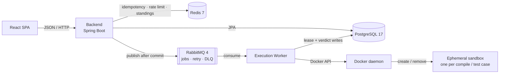

<div align="center">

# Online Judge

**Compile-and-run judging for untrusted code, isolated in ephemeral Docker sandboxes**

<br>

[](https://github.com/AtharvaAgalawe/Online-Judge/actions/workflows/ci.yml)
[](LICENSE)
[](https://openjdk.org/projects/jdk/21/)
[](https://spring.io/projects/spring-boot)
[](https://react.dev)
[](https://www.docker.com)

<br>

*A full-stack judge in Java 21 and React — async judging over RabbitMQ, crash-safe job leases, and six language runtimes behind one hardened container boundary.*

</div>

---

## Overview

Users browse problems, submit source code in one of six languages, and poll for a verdict while it is
compiled and executed against hidden test cases inside ephemeral, locked-down containers.

The system is designed around the three problems a real judge actually has — **correctness under
concurrency and failure**, **safe execution of untrusted code**, and **throughput** — not around CRUD.
The API never blocks on judging, every submission's journey is persisted, and submitted code never
runs outside the sandbox.

| | |
|---|---|
| **Pipeline** | `POST /submissions` → PostgreSQL + RabbitMQ → execution worker → Docker sandbox → verdict |
| **Languages** | Java 21 · Python 3.12 · C 17 · C++ 17 · JavaScript (Node 22) · Go 1.23 |
| **Datastores** | PostgreSQL 17 · Redis 7 · RabbitMQ 4 |
| **Trust boundary** | Only `execution-worker` touches the Docker socket; the backend has no Docker dependency |
| **Spec** | [`PRD.md`](PRD.md) (what & why) · [`AGENTS.md`](AGENTS.md) (engineering rules) |

## What it does

- **Async judging.** `POST /api/v1/submissions` returns `202` immediately. The submission row and its
  job row are written in one transaction; the message is published only after commit, so a rollback
  can never enqueue work.
- **Crash-safe workers.** A job is claimed with a single conditional `UPDATE` on `execution_jobs` —
  the database row is the serialization point, so leases need no application or distributed lock.
  Duplicate deliveries are no-ops; an expired lease resumes without regressing the status.
- **Retry with intent.** Judging outcomes are terminal; infrastructure failures retry with
  Resilience4j, then through a 5s TTL retry queue, then dead-letter. A message is acked only after
  the result commits.
- **One fresh container per compile and per test case.** `--network none`, read-only rootfs with a
  `/tmp` tmpfs, all capabilities dropped, `no-new-privileges`, CPU/memory/pid limits, a non-root user,
  and an external wall-clock watchdog that force-kills the container independently of the process.
- **Contests.** Registration windows, standings with a configurable freeze and ICPC-style penalties,
  and auto-publish for ended public contests.
- **Accounts.** 15-minute HS256 access tokens, hashed 7-day refresh tokens revoked on logout, BCrypt
  cost 12, and `ROLE_ADMIN` enforced at the service layer as well as the route.
- **Frontend.** Problem catalog and filters, CodeMirror editor with per-language templates, live
  verdict polling, submission history, contest views, and an admin dashboard with queue health.

## Architecture

A modular monolith (`backend`, `common`) plus a separately deployable execution worker. The only
asynchronous boundary is the queue.



Lifecycle: `SUBMITTED → QUEUED → PICKED_UP → COMPILING (compiled languages) → RUNNING → EVALUATING`.
`status` tracks the pipeline stage; `verdict` is final and set only together with the terminal
transition. Transitions are validated in one place (`SubmissionStatus.transitionTo`).

1. The API validates the request, applies the per-user rate limit (1 per 3s) and the optional
   `Idempotency-Key`, then inserts the submission and job rows in one transaction.
2. After commit the job is published with a `correlationId`. A worker claims the lease, compiles once,
   and runs one sandbox container per test case.
3. Output comparison normalizes trailing whitespace and blank lines; sample tests always run, hidden
   tests stop at the first failure, and time/memory aggregate as the maximum observed.
4. The verdict, metrics, and every per-case row are committed together, and only then is the message
   acked. The client polls `GET /submissions/{id}/status` until it sees a terminal verdict.

## Verdicts

| Verdict | Meaning |
|---|---|
| `ACCEPTED` | Every test case produced the expected output within the limits. |
| `WRONG_ANSWER` | Output differed on at least one test case. |
| `TIME_LIMIT_EXCEEDED` | A run exceeded its wall-clock budget and was killed by the watchdog. |
| `MEMORY_LIMIT_EXCEEDED` | A run hit its cgroup memory limit. |
| `COMPILATION_ERROR` | The compiler rejected the source; nothing was executed. |
| `RUNTIME_ERROR` | The process exited non-zero (crash, uncaught exception, signal). |
| `SYSTEM_ERROR` | Infrastructure failure after bounded retries; the only verdict that follows a retry. |

Every verdict except `SYSTEM_ERROR` is an expected result of running arbitrary code and is never
retried. The split is explicit in the exception hierarchy, not inferred from a message.

## Design decisions

| Decision | Why |
|---|---|
| Async boundary at the queue | The API stays responsive and workers scale horizontally without API changes; queue depth is the backpressure, not 5xx responses. |
| RabbitMQ, not Kafka | Work-queue semantics: one job, one consumer, per-message ack/retry/DLQ. A replayable event log solves a different problem. |
| One container per test case | Prevents state leakage (files, background processes, timing) at the cost of startup latency — isolation wins. |
| Sibling containers via the host socket | No Docker-in-Docker. The worker process is trusted; submitted code is not. |
| Lease as one conditional `UPDATE` | PostgreSQL already serializes the row; an application or distributed lock would add failure modes without adding correctness. |
| Redis fail-open | Idempotency, rate limiting, and standings are optimizations; if Redis is down they degrade rather than failing requests. |
| Same-origin check by host behind the TLS edge | TLS ends at Caddy or a tunnel, so the browser says `https://host` while the backend sees `http`. Matching the **host** (not scheme) keeps the SPA same-origin without hardcoding hostnames. |
| Honest sandbox claims | Docker shares the host kernel: this is a hardened namespace/cgroup boundary, not a VM. gVisor/Kata/rootless Docker are future work, not claimed guarantees. |

## Repository layout

```
backend/            Spring Boot API — api / service / domain / repository / security / messaging
                    src/main/resources/db/migration/   Flyway, the only source of schema truth
execution-worker/   Headless judging service — consumer / execution / judge (the only Docker client)
common/             Shared entities, enums, DTOs, and the job-message contract
frontend/           React + TypeScript app (src/pages, src/components, src/api) and live verify scripts
infrastructure/     compose stacks, app images + Caddyfile, digest-pinned judge runtime images
docs/               deployment runbook and recorded architecture decisions
PRD.md              product specification (read before implementing)
AGENTS.md           engineering constitution governing every change
```

## Quick start

Runs the services as host processes with the datastores in Docker. Prerequisites: JDK 21, Node 20+,
Docker with Compose v2, and `openssl`.

```bash
# 1. Local credentials — infrastructure/.env is git-ignored, never commit it
if [ ! -f infrastructure/.env ]; then
  umask 077
  cat > infrastructure/.env <<EOF
DB_URL=jdbc:postgresql://localhost:5433/onlinejudge
DB_USERNAME=onlinejudge
DB_PASSWORD=$(openssl rand -hex 24)
RABBITMQ_HOST=localhost
RABBITMQ_PORT=5672
RABBITMQ_USERNAME=onlinejudge
RABBITMQ_PASSWORD=$(openssl rand -hex 24)
REDIS_HOST=localhost
REDIS_PORT=6379
REDIS_PASSWORD=
JWT_SECRET=$(openssl rand -base64 48)
CORS_ALLOWED_ORIGINS=http://localhost:5173
EOF
fi
chmod 600 infrastructure/.env

# 2. Datastores (Postgres is on host 5433 to avoid a native instance on 5432)
docker compose --env-file infrastructure/.env -f infrastructure/docker-compose.yml up -d

# 3. Judge runtime images the languages table references
for img in oj-java21 oj-python312 oj-gcc13 oj-node22 oj-go123; do
  docker build -t "$img" "infrastructure/docker/images/$img"
done

# 4. Packages (Flyway applies the schema on backend startup)
./mvnw -B -DskipTests package
```

Start each service in its own terminal with `set -a; . infrastructure/.env; set +a` first:

```bash
java -jar backend/target/backend-0.1.0-SNAPSHOT.jar            # API :8080, Swagger at /swagger-ui.html
java -jar execution-worker/target/execution-worker-0.1.0-SNAPSHOT.jar   # consumes jobs, runs sandboxes
```

If the Docker socket is not at the default path (for example Colima), export
`DOCKER_HOST=unix://$HOME/.colima/default/docker.sock` in the worker's terminal. Then:

```bash
cd frontend && npm ci && npm run dev     # http://localhost:5173, proxies /api to :8080
curl -s http://localhost:8080/actuator/health
```

There is no UI for self-assigning roles. For a development admin, set
`BOOTSTRAP_ADMIN_ENABLED=true` with `BOOTSTRAP_ADMIN_USERNAME`/`PASSWORD` in the env file and restart
the backend (local profile only), or promote a registered user:

```bash
docker compose --env-file infrastructure/.env -f infrastructure/docker-compose.yml exec postgres \
  psql -U onlinejudge -d onlinejudge -c \
  "INSERT INTO user_roles (user_id, role_id) SELECT u.id, r.id FROM users u, roles r
   WHERE u.username = 'alice' AND r.name = 'ROLE_ADMIN' ON CONFLICT DO NOTHING;"
```

## API

REST under `/api/v1`, `Authorization: Bearer <accessToken>`, errors always RFC 7807
(`application/problem+json`). The OpenAPI spec is generated from controller annotations: browse
`/swagger-ui.html` (or `/v3/api-docs`) on a running backend.

| Area | Endpoints |
|---|---|
| Auth (public) | `POST /auth/register`, `POST /auth/login`, `POST /auth/refresh` |
| Auth (user) | `POST /auth/logout` |
| Problems (public) | `GET /problems?page&size&difficulty&tag&search`, `GET /problems/{slug}`, `GET /problems/{slug}/stats` |
| Languages (public) | `GET /languages` |
| Submissions (user) | `POST /submissions` (+ optional `Idempotency-Key`), `GET /submissions/{id}`, `GET /submissions/{id}/status`, `GET /submissions?problemId` |
| Contests (public) | `GET /contests?status`, `GET /contests/{id}`, `GET /contests/{id}/problems/{slug}`, `GET /contests/{id}/standings` |
| Contests (user) | `POST /contests/{id}/register`, `DELETE /contests/{id}/register` |
| Admin | `/admin/problems*`, `/admin/contests*`, `/admin/submissions`, `/admin/system/queue-status` |
| Operations | `GET /actuator/health` (public, backend only) |

```bash
curl -s -X POST http://localhost:8080/api/v1/auth/login \
  -H 'Content-Type: application/json' \
  -d '{"username":"alice","password":"secret123"}'

curl -s -X POST http://localhost:8080/api/v1/submissions \
  -H "Authorization: Bearer $ACCESS_TOKEN" -H 'Content-Type: application/json' \
  -H 'Idempotency-Key: demo-1' \
  -d '{"problemId":1,"languageId":1,"sourceCode":"print(1)"}'

curl -s http://localhost:8080/api/v1/submissions/1/status -H "Authorization: Bearer $ACCESS_TOKEN"
```

## Configuration

No secret is hardcoded or committed; everything comes from the environment and both services default
to the `local` profile.

| Variable | Used by | Purpose |
|---|---|---|
| `DB_URL`, `DB_USERNAME`, `DB_PASSWORD` | backend, worker | Database connection |
| `RABBITMQ_HOST`, `RABBITMQ_PORT`, `RABBITMQ_USERNAME`, `RABBITMQ_PASSWORD` | backend, worker | Broker connection |
| `REDIS_HOST`, `REDIS_PORT`, `REDIS_PASSWORD` | backend | Idempotency, rate limit, standings cache |
| `JWT_SECRET` | backend | HS256 key, base64, ≥32 bytes decoded |
| `CORS_ALLOWED_ORIGINS` | backend | Allow-list for a **separately hosted** frontend only |
| `DOCKER_HOST` | worker | Non-default Docker socket path |
| `BOOTSTRAP_ADMIN_*` | backend (`local` only) | Optional dev admin bootstrap |

Requests from the SPA served by the bundled edge are same-origin and need no CORS entry. Execution
limits are grouped `@ConfigurationProperties` values (compile timeout 60s, watchdog buffer 2s,
512MB compile memory, 64 pids, 64KB captured output per stream, 60s lease) — see
`application.yml` and PRD §18 rather than duplicating them here.

## Testing

| Suite | Command |
|---|---|
| Java fast suite (unit + Checkstyle + SpotBugs) | `./mvnw -B verify` |
| Java full suite (+ Testcontainers and sandbox tests) | `./mvnw -B verify -P docker-tests` |
| Frontend | `cd frontend && npm ci && npm run lint && npm run test && npm run build` |
| Live solver journey | `node frontend/scripts/verify-phase11-live.mjs` |
| Live admin journey | `BASE_URL=http://localhost:8080 ADMIN_USER=<admin> node frontend/scripts/verify-phase12-live.mjs` |

The Docker-backed suite is not garnish: it includes adversarial fixtures — infinite loop, memory hog,
network attempts, writes outside `/tmp`, thread explosions, output bombs — plus the full worker flow
against real PostgreSQL and RabbitMQ. The live scripts print `PASS`/`FAIL` per step and exit non-zero
on the first failure.

> **Docker Desktop / Colima** must be told where the socket is, and its Ryuk and sandbox workspaces
> must use paths the VM can mount (Colima shares `$HOME`, not macOS's `/var/folders`):
>
> ```bash
> mkdir -p ~/oj-test-tmp
> DOCKER_HOST=unix://$HOME/.colima/default/docker.sock \
> TESTCONTAINERS_DOCKER_SOCKET_OVERRIDE=/var/run/docker.sock \
> ./mvnw -B verify -P docker-tests -DargLine="-Djava.io.tmpdir=$HOME/oj-test-tmp"
> ```
>
> Drop the variables you don't need: without `DOCKER_HOST` the suite finds no daemon, without the
> override Ryuk fails to mount the socket, and without `java.io.tmpdir` sandbox containers see empty
> bind mounts (`file not found: /box/src/Main.java`).

CI (`.github/workflows/ci.yml`) runs a repository hygiene guard (fails if `.env` or credential
material is tracked), the full Java suite with Docker-backed tests, and the frontend
lint/test/build on every push and pull request.

## Deployment

The whole system runs on **one host with Docker Compose**: Postgres, Redis, RabbitMQ, backend,
worker, and a Caddy edge that serves the built SPA and proxies `/api`, so the browser stays
same-origin.

```bash
docker compose -f infrastructure/docker-compose.prod.yml --env-file infrastructure/.env up -d --build
```

There is no PaaS option — the worker needs the host Docker socket to launch sibling sandboxes, which
Fly.io, Render, Railway, and unprivileged Kubernetes do not expose. x86_64 and arm64 both work; the
judge base images are pinned by manifest-list digest.

Host sizing, DNS/TLS, secrets, image builds, updates, backups, rollback, and the **laptop + tunnel
demo** path are in [`docs/deployment.md`](docs/deployment.md); the topology rationale is in
[`docs/decisions/0002-deployment-topology.md`](docs/decisions/0002-deployment-topology.md).

## Security model

- **Untrusted code never runs on the host, a CI runner, or the backend process** — only inside the
  worker's sandbox containers. The backend module has no Docker client dependency at all.
- Every sandbox run: `--network none`, read-only rootfs with a writable `/tmp` tmpfs only,
  `--cap-drop=ALL`, `no-new-privileges`, CPU and memory limits with swap equal to memory, a
  `pids-limit`, and a non-root user. The worker itself should run as non-root too.
- Every run is bounded by an external watchdog; the worker never waits forever on the Docker API.
  Hidden test content is never returned by any endpoint.
- Inputs are validated at the DTO boundary, all database access goes through parameterized
  JPA/Hibernate, secrets come from the environment, and tokens and password hashes are never logged.
- **Honest limitation** (PRD §18/§25): Docker shares the host kernel, so this is a hardened
  namespace/cgroup boundary, not a VM. The claim is "safe against typical adversarial
  competitive-programming submissions", not kernel-exploit-proof isolation.

## Status

Implemented: PRD phases 1–12 (schema, auth, problems, submissions, queue, worker leases, sandbox,
verdict engine, history, frontend, admin), the six-language judge catalog, contests with standings and
auto-publish, CI, and the single-host deployment path.

Not yet: Redis read-through caching (phase 13), Micrometer metrics and tracing (phase 14), broader
failure-mode tests (phase 15), the `cd.yml` publish workflow (phase 16), and a measured load test
(phase 17) — so no latency numbers are claimed anywhere before that measurement exists. Orphaned jobs
are surfaced to an operator in `/admin/queue` rather than re-queued by a reconciler.

## Troubleshooting

| Symptom | Fix |
|---|---|
| `port is already allocated` | Another service owns `:5433`/`:6379`/`:5672`; remap it in `infrastructure/docker-compose.yml` and update `DB_URL` or the matching client variable. |
| Startup fails on a JWT error | `JWT_SECRET` is missing or decodes to <32 bytes — regenerate with `openssl rand -base64 48`. |
| `403 Invalid CORS request` on login | The `Origin` host differs from the `Host` the backend received — check the proxy preserves `Host`, or set `CORS_ALLOWED_ORIGINS` for a separately hosted frontend. |
| Submissions stay queued | Confirm the worker is running, check RabbitMQ (`:15672`), then inspect `/admin/queue` for stale leases. |

<div align="center">

**[PRD](PRD.md) · [Deployment runbook](docs/deployment.md) · [Architecture decisions](docs/decisions/) · [Contributing rules](AGENTS.md)**

*MIT licensed — see [LICENSE](LICENSE)*

</div>
